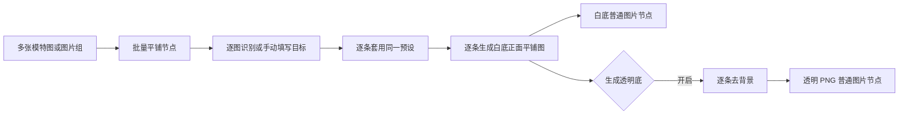

# 当前方案：批量正面平铺与透明底

## 已确定的产品方向

本文件取代初始调研中关于正背合图、拆图及批量仅作后续扩展的产品建议；初始文档中的参考源码事实仍保留。

- 使用用户已验证有效的提示词方向：只生成一个目标单品的正面立体平铺图，居中、纯白背景、排除模特和其他搭配。
- `{目标单品}` 来自逐图识别或人工填写，允许逐条修改；预设提示词可展开编辑。
- 批量是核心需求；单图只是同一批量流程里只有一条任务的情况。
- 透明底采用腾讯云数据万象，优先复用 MindFrame 的 GoodsMatting / AIPicMatting 接入经验；新画布实际调用尚未验证。
- 本轮仅完善方案与可行性调研，没有开始代码实现或付费调用。

## 批量节点

建议增加“批量平铺”专用节点，接收多张图片节点或图片组。每张输入生成独立任务，保留源节点 ID，不把整批图作为一个生成请求的多张参考图。

节点提供输入缩略图列表、逐条目标短语与状态、统一模型与尺寸、透明底开关、开始/停止、失败项重试。收起时显示进度摘要；结果按每个输入一组排列，白底与透明底保持对应，原图和旧运行结果都保留。

同类服装可批量填写统一目标，混合款式可逐图识别后修改。不增加每条都要弹窗审批的流程，也不把“多件独立款式”自动解释为“同款多角度参考”。

已核对 `plugins/canvas/batch-list/src/logic.ts` 与节点组件：现有批量是变量笛卡尔积 × 提示词，并共用上游参考图。可借鉴调度、进度和布局；服装任务需要独立输入映射和分阶段恢复，不能直接复用其产品语义。

## 透明底可行性

推荐保持“先生成白底，再对同一结果做分割抠图”的结构。这样无需重新生成衣服，能同时留下白底版和透明版；去底失败不应再次调用生图。

技术路径已有：

| 路线 | 已核实依据 | 本项目尚需验证 |
| --- | --- | --- |
| 浏览器本地推理 | [IMG.LY background-removal](https://github.com/imgly/background-removal-js) 支持浏览器抠图，仓库标注 AGPL-3.0；[BiRefNet 官方仓库](https://github.com/ZhengPeng7/BiRefNet) 列有使用 BiRefNet_lite 和 ONNX Runtime Web 的第三方案例 | 选定包/权重的许可、下载与缓存、浏览器性能、内存及白衣/针织/蕾丝边缘质量；不是已经在当前画布跑通 |
| 自建或已有推理服务 | BiRefNet 官方提供模型与推理资料；原参考 ComfyUI 使用 BiRefNetUltra | 实际服务地址、运行机器、模型部署和网络可达性，不能假定已有可用服务 |
| 商业去底 API | [remove.bg 官方 API 文档](https://www.remove.bg/api.doc) 提供商品前景去底接口，但公告自 2026-12-01 起迁移至 Leonardo.Ai | 不能直接锁定旧 endpoint；需核实实际可选服务的新协议、费用、账号和 CORS |

用户后续明确优先使用腾讯或阿里服务，且已在 MindFrame 使用腾讯。本轮已找到该实现，因此选腾讯云数据万象作为首个接入目标；上表其余方案仅保留为此前调研，不再作为当前实施主线。具体复用依据与实施入口见 [开发准备](flatlay-implementation-brief.md)。

透明 PNG 必须有实际 alpha 通道，不能把棋盘格画进图片，也不能简单删除白像素；白色服装和镂空材质应是重点验收样本。

## 批量可靠性与验收

- 每条任务绑定输入、目标、模型、提示词快照和运行 ID，处理中修改设置只影响后续新运行。
- 单条失败不阻断其他任务；状态区分识别失败、生成失败、去底失败，以及请求结果未知。
- 去底失败保留白底图；重试只做失败环节。已完成项不随“重试失败项”重新生成。
- 停止阻止后续任务提交，取消不能承诺撤销上游已发生的费用；结果未知不自动重发。
- 刷新后保留已完成产物和队列状态，不无条件自动继续付费生成。
- 结果按实际图片比例布局，白底/透明底可预览、继续连接、下载和批量导出。
- 验收覆盖混合款式逐图归属、目标覆盖编辑、失败恢复、刷新、重跑不覆盖旧图、alpha 与服装边缘。
- 并发、超时、自动重试和数量上限尚未确定；实施前按项目约定说明默认值和失败处理并确认，不直接沿用旧批量节点的常量。

已复核 TODO/pending-test：本轮仍无实现和可测试功能变更，不新增待测或 CHANGELOG 条目。
