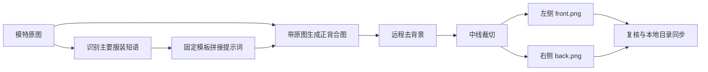
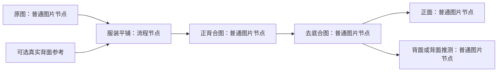

# 服装平铺生成流程与自由画布接入调研

> 后续用户已确定改为单件正面平铺，并要求批量及透明底能力。当前产品方案以 [批量正面平铺与透明底](flatlay-batch-direction.md) 为准；本文保留参考项目事实和最初建议，正背合图/拆图不再是待实现目标。

## 结论与范围

这项能力适合进入现有自由画布。应吸收的是“明确目标服装 → 参考图重绘成正背平铺图 → 去底 → 拆分 → 复核与局部重做”的工作方法，不是复制批次后台、数据库和文件夹管理页面。

建议以一个轻量“服装平铺”流程节点组织操作，以普通图片节点保存中间图和最终正背图。现有宿主已经能够带图识别、图生图、分割图片、保存与导出；新增重点是服装语义、步骤状态、产物归属和去背景服务。工作流模板目前只是复制节点与连线，不是依赖调度器，不能仅靠连线就自动跑完整链路。

本轮只完成独立 Worktree、源码与素材调研、适配建议。没有实现功能，没有安装或启动参考项目，没有调用识别、生图、抠图服务，没有产生付费生成，也没有提交、推送或合并。

## 证据范围与工作区

| 对象 | 本轮核实结果 |
| --- | --- |
| 参考仓库 | https://github.com/Jiqize/flatlay-internal-tool ，私有仓库，使用当前 gh 权限只读克隆 |
| 参考快照 | `ed07f36032ad0764d2ca573916668046f74b4c75` |
| 参考本地目录 | `/Users/lianglei/Projects/git/flatlay-internal-tool` |
| 新 Worktree | `/Users/lianglei/Projects/git/new-infinite-canvas.codex-worktrees/flatlay-canvas` |
| 实验分支 | `codex/flatlay-canvas` |
| 创建基线 | 当前工作区 `feat/node-pack` 的 `cf2417c`，包含现有姿势参考等节点能力 |
| 隔离边界 | 原目录未提交的 PROJECT.md、.playwright-mcp/、docs/research/ 均未复制或修改；未合入魔搭实验分支 |
| 验证方法 | 阅读实际代码、解析 ComfyUI JSON 的节点和连线、查看仓库三张原始截图、对照宿主调用与存储链路 |
| 尚无证据 | 当前供应商可用性、真实费用、识别准确率、正背还原质量、抠图质量、浏览器端实际跨域能力 |

公开网页读取不到该私有仓库，结论来自授权克隆的固定源码快照。仓库中的旧 PASS 文档不是本轮运行证据。三张 PNG 是工作流/提示词截图，没有可用于证明真实服装还原质量的输入输出对照。

## 参考项目有两套实现

### 原始 ComfyUI 工作流

来源：仓库根目录 `模特图转平铺 (1).json` 的主图与 `definitions.subgraphs`，以及三张配套截图。

1. `LoadImage` / `Load Image Batch` 提供单张或文件夹输入，`easy imageSwitch` 选择生成输入。
2. 识别子图使用 `LayerUtility: ZhipuGLM4V`，配置为 `glm-4.5v`，输出主要服装短语。
3. `ttN concat` 将固定前缀、服装名称、固定平铺要求拼接，再用 `ShowText` 展示。
4. `GeminiOpenAIProxyNodeV2` 带原图生成；保存配置为 `gemini-3-pro-image-preview`、`3:2`、`2K`。这是工作流快照参数，不代表现在该模型可用。
5. 另一处图像开关允许使用生成结果或已加载的结果图，独立运行后处理。
6. 后处理子图使用 `LayerMask: BiRefNetUltra`，包含 `VITMatte`、`cuda` 配置，再用 `easy imageSplitGrid` 按 1 行 2 列拆图，分别保存。

**接线缺陷：** 节点 19（单图）经 link 48 连识别节点 41；批量图节点 18 经节点 20 连生图节点 1。批量模式下，识别并不跟随当前批量图。这是静态连线可确认的输入错配风险；不能把此接法搬进画布。

本地 CUDA/BiRefNet 依赖属于 ComfyUI 版本，不能据此宣称浏览器已有抠图能力。

### Web 内部工具

Web 版使用 React/Vite 前端、FastAPI/SQLAlchemy 后端；每个上传文件建独立 Item，逐件识别同一 Item 的原图，因此没有上述固定单图接线问题。任务可用进程内队列或 Redis，产物可写本地目录或 S3。

| 步骤 | 实际行为 | 依据 |
| --- | --- | --- |
| 导入 | 文件夹选择，过滤图片，创建批次并逐张入队；不是根据图片自动归并同一款多视角 | `frontend/src/features/intake/BatchCreatePage.tsx`；`backend/app/services/ingest.py` |
| 识别 | 一张图片加文本指令，请求 `/v1/chat/completions`；默认 `glm-4v`，输出最主要的一件、不含颜色、十字以内的短语 | `backend/core/providers/comfly.py:29`；`backend/core/config.py` |
| 提示词 | 模板 v1 要求白底无阴影、左正右背、只留目标单品、去模特和其他搭配、尽量保留版型材质细节 | `backend/core/prompts.py` |
| 生图 | 原图和 prompt 通过 multipart 提交 `/v1/images/edits`；默认 `nano-banana-2-2k`、3:2、2K；接收 URL 或 base64 结果 | `backend/core/providers/comfly.py:100` |
| 去底 | 将生成的整张合图送外部 RMBG；支持通用 `/v1/remove-background` 和 remove.bg 协议；并非本地 BiRefNet | `backend/core/providers/rmbg.py:32` |
| 拆分 | Pillow 按 `width // 2` 切左右两半，分别命名 front/back，不做主体检测、正背识别或自动留白裁切 | `backend/app/services/image_splitter.py:9` |
| 保存 | 原图、短语、提示词、合图、去底合图、正面、背面、日志分别记 Artifact | `backend/app/domain/artifacts.py`；`backend/app/services/pipeline.py` |
| 复核 | 展示图片、修改短语、查看步骤日志；可重试失败环节、重新出图、从头重做 | `frontend/src/features/review/ReviewDrawer.tsx`；`backend/app/api/routes/items.py` |
| 同步 | 浏览器取得目录权限后下载 manifest 和产物，逐件回报已同步；不是后台自动写用户电脑 | `frontend/src/features/sync/syncQueue.ts`；`useDirectorySync.ts` |

识别短语只负责“指定哪一件”；服装视觉信息来自原图。十字、不含颜色只是模型指令，代码没有严格检验长度与语义，也没有多单品候选、分割框或人工选择目标区域。

## 重跑、费用和可靠性边界

正常单件完整运行包含一次视觉识别、一次图像编辑、一次去底请求，再本地裁切；不等于每一步都必然收费，具体取决于服务账号。本轮未查询或估算价格。

- “重新出图”沿用当前短语，从生成开始，之后仍跑去底和拆分；“从头重做”重新识别，可能覆盖人工修改的短语。
- “重试失败环节”可从生成、去底或拆分开始，后两者复用已存合图；不是每次都重新生图。
- 参考实现遇到 `ContentRejectedError` 会切换另外两条提示词继续调用，其他 AppError 直接失败。这是参考行为记录，不作为新功能默认；服务明确拒绝应向用户呈现原因，不照搬自动换词重试。
- `run_number` 和 `is_current` 留在数据库记录里，但存储路径不含 run：同一 Item 的 combined/front/back 文件会覆盖。它不能作为可靠的旧版本保留方案。
- 从去底/拆图恢复时仍会先写一次主提示词记录，存在记录与此前实际采用的 fallback 提示词不一致的风险。新流程应保存每次实际提交的输入快照。
- Pipeline 步骤内主要 `flush`，外层 session 在整项任务结束时提交，不能仅凭前端有状态字段就认定每个阶段都能实时观测。
- Inline 队列是进程内、单 worker 顺序消费；Redis 使用 `lpop` 后执行，没有看到在途确认与崩溃自动归还机制。重启恢复能力不能照 README 想当然。
- 代码存在“Gemini 请求超过 60 秒疑似降级”的提示，这是耗时启发式，不能证明真实模型被替换。

以上是与迁移设计直接相关的源码风险，不是对参考项目运行环境的完整安全审计。

## 服装结果到底意味着什么

这是照片风格的服装平铺商品图，不是带尺寸、工艺或结构线的服装技术平面图，更不是纸样。

背面没有被原图展示时，只能由生成模型推测。白底、正背一致、图案还原和正确的左右位置都靠生成结果满足提示词；代码没有测量或校验这些条件。建议在画布明确把这类结果称为“背面（推测）”；用户提供真实背面参考后才有额外依据，仍需视觉复核。

必须人工关注：版型和衣长、领口袖口、门襟纽扣、印花文字、针织纹理、透明/蕾丝区域、口袋，以及左右两图是否真的正背不同。抠图还应检查是否丢掉一件、吃掉白色衣服边缘、残留阴影或破坏镂空。

## 自由画布的实际基础

| 能力 | 当前证据 | 适配判断 |
| --- | --- | --- |
| 带图识别 | `use-plugin-host.tsx:81` 的 `ai.generateText` 支持 images、模型选择、signal | 可复用；需选择支持视觉输入的文本模型，列表归类为 text 不等于一定能识图 |
| 图生图 | `use-plugin-host.tsx:55` 按是否有 references 调 `requestEdit` / `requestGeneration` | 可复用宿主配置，不单独存 Comfly 密钥 |
| 图片输入 | SDK `getUpstreamImages` 支持图片、插件资源和组 | 可复用读图；批量任务还需保留源节点 ID，不能仅以 URL 列表表示归属 |
| 图片分割 | `canvas-image-data.ts:41` 支持行列及自定义分割线；`project.tsx:2047` 会存图并创建连线结果 | 已有一行两列和偏移分割线能力；需做正背命名及专用衔接 |
| 画布操作 | `CanvasNodeContext.applyOps`，SDK `buildImageNodeOps` 可加图和连线、保持原比例 | 可用于产物布局；不是持久化和调度的完整封装 |
| 存储 | `image-storage.ts` 使用 localforage/IndexedDB；原图 storageKey 与预览分开 | 应复用，结果不要只留 blob URL 或大块临时 React 状态 |
| 插件存储 | `ctx.storage` 是按插件命名空间隔离的本地存储 | 可存配置；只在此处存图还需处理宿主导出与图片回收覆盖问题 |
| 模板 | `workflow-template` 保存和实例化组内节点、位置和连线 | 可保存将来组合，但没有自动顺序执行语义 |
| 现有批量 | `batch-list` 是变量笛卡尔积 × 提示词，共用上游参考图 | 不能直接当作“一张输入独立识别并处理一件衣服”的队列 |
| 生成画廊 | `use-generation-recorder.ts` 跟踪图片/视频 loading → success，且要求 storageKey | 插件直接添加 success 结果不会自动获得同等记录，需专门接入 |
| 导出 | `canvas-export.ts` 已支持节点图片与项目 zip | 可复用；不必为了本功能复制自动目录同步后台 |
| 去背景 | 在现有 web/src 与 plugins 检索未找到独立去背景服务 | 是真实缺口；图片 API 的 `background=transparent` 不是既有图片抠图 |
| 刷新恢复 | `resetInterruptedGeneration` 对非视频 loading 标为中断错误 | 没有图片任务通用续跑；平铺不能承诺刷新后自动续费重跑 |

更具体的接口限制：

1. SDK 目前不直接暴露 `splitDataUrl` 或 `uploadImage`。若做独立插件，应由宿主增加最小图片处理/保存能力，不能在插件里越界导入 web 私有源码并假装是现成 SDK。
2. SDK `generateImage` 返回图像字符串，缺少完整任务 ID、实际参数、产物 storageKey。`buildImageNodeOps` 只组装节点。需确保保存、历史记录与流程关联在同一条受控完成路径上。
3. `applyOps(run_generation)` 是异步发起，不提供可 await 的阶段完成结果。不能把多个此操作顺次放数组里就认为识别结果会先到、再供生成使用。
4. 当前分割工具 `loadImage` 没有 onerror 拒绝路径；远程图也必须先变成可读 Blob/Data URL，避免跨域污染 Canvas。新增流程的失败状态必须覆盖这些问题。
5. 自定义分割线后，现有页面创建节点的尺寸仍按平均行列推算；专用正背输出应按实际裁片像素比例布局，避免分割线偏移时显示变形。

## 建议的画布交互

这是建议的数据和产物关系，不是说现有连线会自动调度。

用户把原图连进“服装平铺”，可以直接填写“针织背心”等目标，也可以点击识别获取建议。目标可编辑，识别不是每次生成的必经步骤。点击生成时固定本次原图、目标短语、模型、提示词和尺寸；生成之后可继续去底、拆分，也可以单独重做后处理。

节点收起时只显示目标、步骤进度和主要动作；展开面板再放模型、比例、提示词、背景处理和分割设置。采用当前画布主题和扁平按钮；节点空白区可拖，输入和操作控件单独拦截事件。避免在画布塞一整套批次列表后台。

结果是独立、可继续连接的图片节点，原图不被覆盖。同一输入重跑新建一组结果，旧结果继续保留；拆分调整可用原合图重做，无需重新付费生图。复杂套装不自动决定“整套还是某件”，以用户填写目标为准。

批量扩展时按源节点逐件建立任务，将识别短语、结果、失败步骤归回对应输入。多张独立款式与同款正背参考不能使用同一种“把所有上游图一起发给模型”的含义；首轮以单件流程证明质量，再扩展明确的逐件批量入口。

## 实现组织建议

推荐“薄插件界面 + 宿主复用能力”，不新增后端、通用 DAG 引擎或另一个图片数据库。

| 层 | 建议落点/责任 |
| --- | --- |
| 专用节点 | `plugins/canvas/flatlay/`：目标短语、操作与步骤展示、输入输出关系；沿用节点管理安装方式 |
| 服装逻辑 | 专用纯函数：提示词构造、阶段依赖、重跑起点、输出标记 |
| 宿主桥接 | `web/src/pages/canvas/hooks/use-plugin-host.tsx` 与宿主/SDK 类型同步；按真实需要补图片保存和分割能力 |
| 外部去底 | `web/src/services/api/`：只有确定服务之后才增加对应适配；复用现有配置与允许的代理机制 |
| 状态与持久化 | 画布节点存可恢复流程摘要和源/产物 ID；业务运行状态如需跨组件共享放 `web/src/stores/canvas/`；图像二进制复用 image-storage |
| 生成记录 | 保留 prompt/model/输入快照及生成合图记录；本地裁切不要冒充额外模型生成 |

每次运行至少区分输入源、runId、目标短语、提示词版本与实际提交内容、所选模型、阶段、产物节点/存储引用、错误及是否可重做。提交中修改原图或短语不能污染正在执行的运行；删除节点、取消、切换画布后迟到结果不能写回新任务。阶段产物应先持久化，再推进下一阶段。

这些字段是流程可靠性所需，不意味着先做复杂数据库或历史迁移。既有业务历史必须保留，不能复制参考项目覆盖文件的行为。

## 去背景的决策边界

| 路线 | 能得到什么 | 仍需查证 |
| --- | --- | --- |
| 先生成白底并拆分 | 可以先验证平铺与画布交互，不增加去底供应商 | 不是透明 PNG；不能称为完成原流程全部能力 |
| 对接远程去底服务 | 最接近 Web 工具流程，模型生图与分割能力分离 | 实际 endpoint、授权、费用、CORS、输出 MIME/alpha、双件完整性 |
| 对接本地 BiRefNet 服务 | 更接近 ComfyUI，能复用已有模型服务则有价值 | 当前是否已有服务、硬件、模型与许可、接口；本轮没有证据支持已可用 |
| 浏览器端抠图 | 有潜力减少远程依赖 | 包体、模型下载、运行后端、内存、质量与许可；本轮未选库，不能宣称可直接落地 |

推荐先验证白底正背合图与拆分，同时把透明底保留为完整流程的明确缺项；如果第一版就要求透明结果，先落定一个实际可用去底服务。不能用“提示模型生成透明背景”或简单白色阈值替代可靠抠图，尤其对白色、蕾丝和半透明服装。

参考的 3:2/2K 只能作为候选预设，实际可用尺寸要跟宿主模型适配。新增并发、重试、超时和输入大小限制实施前依项目约定说明适用环节、默认值与失败处理，再确认；本轮没有引入任何新边界值。

## 后续实施与验收顺序

这只是建议，不代表本轮已授权实施。

1. 单件闭环：原图 → 可编辑目标 → 正背合图 → 可调拆分 → 普通图片节点与导出。真实输入输出验证能否保住款式；白底阶段明确标注未做透明化。
2. 完整后处理：接实际去底能力，检查 alpha 与服装边缘；去底或拆分失败时复用成功合图，不重复生图。
3. 可靠性与逐件批量：版本保留、取消/刷新中断、结果归属、失败项单独续做、模板复用和生成画廊。

验收应覆盖：

- 单一明显服装、多件叠穿、印花文字、针织、白色服装、镂空/半透明服装；真实背面参考与只有正面两种情况。
- 识别是否挑中目标；修改目标后只影响新运行；正背方向、款式细节和非目标配件残留由人复核。
- 合图居中、偏心、只有一个视图、主体跨中线等情况；可调分割、不误称智能识别、不拉伸。
- 远程下载失败、无法解码、没有透明通道、取消、节点删除、刷新中断；阶段状态与可恢复产物一致。
- 重跑保存旧结果；只拆图不新增模型调用；明确失败与“请求结果未知”不同，不盲目重新提交。
- 保存重开后原图、合图、正背图及引用可用；生成画廊记录恰当；PNG/zip 导出可打开。
- 深浅主题、空白区拖动、控件输入、结果继续连接其他节点。
- 批量时每件原图与其识别/生成结果一一对应，不能沿用原 ComfyUI 的固定单图识别接线。

## 本轮交付核对

独立工作树与源码快照已核实；调研覆盖原始 JSON、Web 识别/生成/去底/拆分、队列、重跑、存储、复核与同步，以及现有画布 SDK/图片服务/拆分/导出/历史链路。只修改本工作树的调研文档和状态索引。

已检查 `docs/content/docs/progress/todo.mdx` 与 `pending-test.mdx`：本轮没有实现待办或新增可测试功能，因此不移动事项、不新增“已实现待测”记录；`CHANGELOG.md` 与正式功能说明无需修改。未执行语法检查、构建或测试，也未将参考仓库历史测试声明当作本轮验收。
